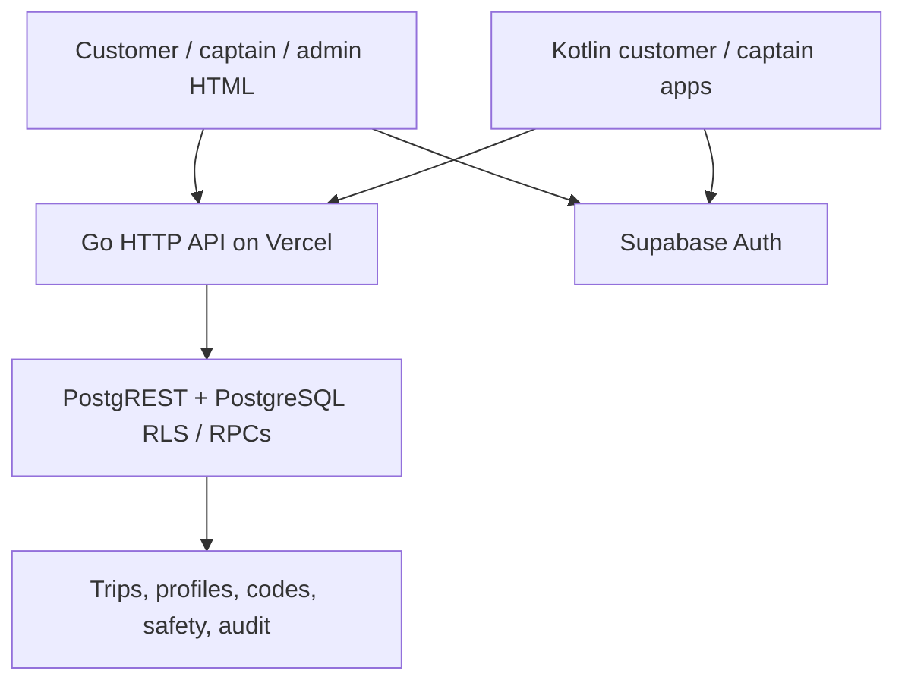

# Architecture

The API holds no authoritative process-local business state. It uses bounded request/response sizes, a 10-second upstream timeout, shared HTTP connection pooling, exact-origin CORS and bearer-token forwarding. RPC functions implement authorization and transactions; direct authenticated database table writes are revoked.

`raahi_transition_ride` locks a trip row before acceptance or a transition. Unique partial indexes enforce one active trip per customer and per captain, including under competing transactions. `raahi_book_ride` keys successful retries by `(customer_id, request_key)`. Captain rejections are scoped to that captain rather than cancelling a customer's request.

## API contract

All paths below use `/v1/`. Health is unauthenticated; others require `Authorization: Bearer <Supabase access token>`.

| Method | Path | Body / result |
|---|---|---|
| GET | health | Service liveness only; not a database readiness probe |
| GET | profile | Current profile array |
| GET | rides | Latest 100 rows visible through RLS |
| GET | captains | Profile subset; administrative visibility through RLS |
| GET | audit | Latest 100 audit rows; administrative visibility through RLS |
| POST | book | `p_pickup`, `p_destination`, `p_pickup_lat`, `p_pickup_lng`, `p_drop_lat`, `p_drop_lng`, `p_mode`, `p_request_key` |
| POST | transition | `p_ride_id`, `p_action` (accept/reject/arrive/start/complete/cancel), optional `p_code` |
| POST | code | `p_ride_id`; customer-owned start code |
| POST | approve | `p_captain_id`, `p_approved`, `p_reason` |
| POST | availability | `p_online` |
| POST | location | `p_lat`, `p_lng` |
| POST | tracking | `p_ride_id`; assigned captain's last shared position |
| POST | sos | `p_ride_id`; records an alert UUID |

PostgREST error statuses and JSON are forwarded; there is no stable application-specific error-code taxonomy yet. JSON mutation bodies are limited to 16 KiB; upstream response copying is capped at 2 MiB. GET lists are intentionally bounded, not a complete historical export.

## Scaling roadmap

Use one geographic deployment region close to the database for a pilot. Keep transactions small, analyze dispatch queries and add city/service scoping. Introduce spatial indexing, expiring offers and a transactional outbox before a distributed dispatch worker. Move location events to an appropriate managed realtime channel with scoped participant access. Add queue workers for notifications and settlements, an append-only money ledger, load/race tests against the real database and measured latency/error budgets. Scale only after those measurements justify it.

The current polling design avoids depending on long-lived function connections. It does not promise instantaneous delivery. Vercel documentation returned inconsistent WebSocket guidance during research, so this implementation deliberately uses ordinary HTTP.

All application tables and RPC function names in Supabase are prefixed `raahi_`; public HTTP API paths remain `/v1/...`. Database migration grants/revokes are scoped only to Raahi objects, preserving unrelated application permissions.
